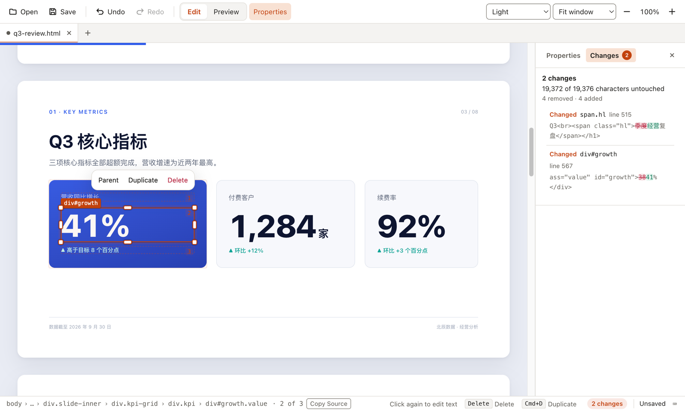
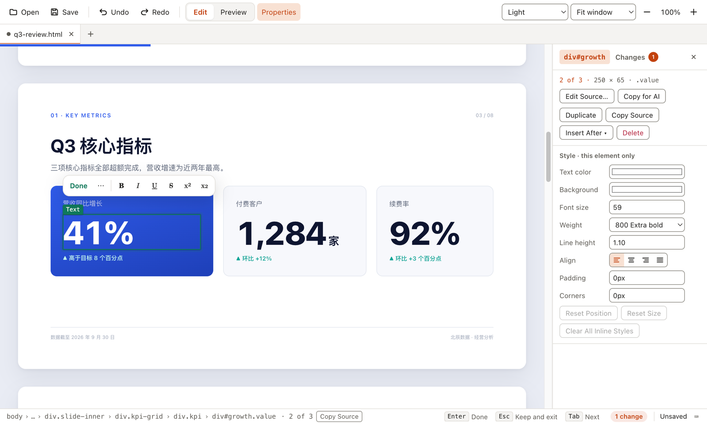
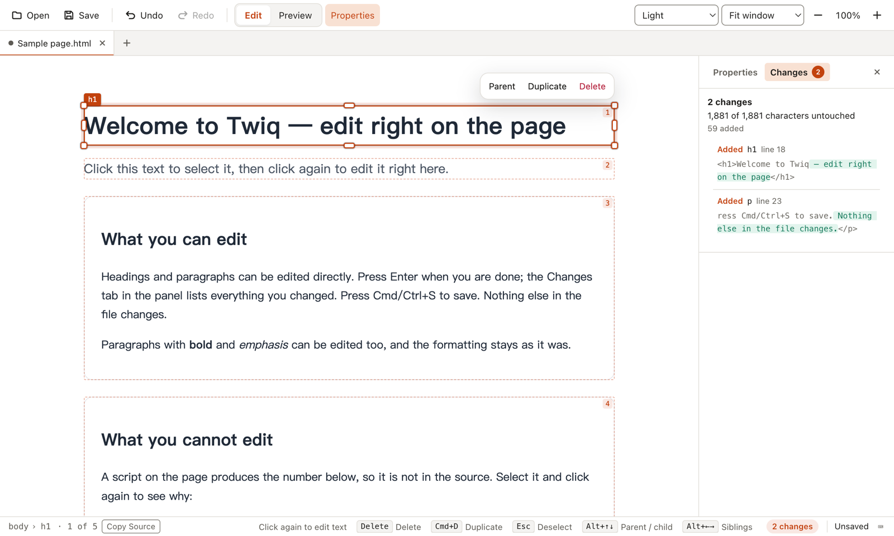

<p align="center">
  
</p>

<h1 align="center">Twiq</h1>

<p align="center"><b>Edit AI-written HTML with a click.</b></p>

<p align="center">Edit AI-made slides, reports and landing pages right on the page; saving touches only what you changed.</p>

<p align="center"><a href="https://github.com/rog3r1999/twiq/releases/latest"><b>Download Twiq</b></a>　macOS / Windows · free and open source</p>

<p align="center"><a href="README.md">简体中文</a> · <b>English</b></p>


From the promo film: working through five review comments on an AI-written slide deck. The Twiq part is a real screen recording, uncut and at normal speed; the [full film](#the-full-film) is below.

## Why Twiq

Many AI-made slide decks, reports and landing pages are really HTML files. To change one number you either dig through the source or ask the AI to rewrite the whole file and hope it leaves everything else alone.

- **Click to edit**: click to select, click again to type. Adjust size, color and alignment in the property panel; drag blocks to move them.
- **Only what you changed**: saving writes just the characters you edited. Indentation, attribute order and line endings stay as they were, and nothing else gets touched.
- **See every change**: the Changes tab lists each edit so you can review them before saving, and revert just one.
- **Works alongside your AI**: let the AI do big rewrites and make small fixes yourself. **Copy for AI** hands it only the part you selected; when it saves, Twiq reloads the file.



One word changed on the cover and 38% changed to 41%: 19,372 of 19,376 characters untouched.

## Download

**Download Twiq** from [Releases](https://github.com/rog3r1999/twiq/releases/latest). It is free and open source (MIT).

| System | File |
|---|---|
| macOS, Apple silicon (M1 and later) | `Twiq-<version>-arm64.dmg` |
| macOS, Intel | `Twiq-<version>.dmg` |
| Windows 10 / 11 (x64) | `Twiq-Setup-<version>.exe` |

**First launch on macOS.** The app is not notarized by Apple yet, so macOS blocks it the first time:

1. Open the dmg and drag Twiq into **Applications**.
2. Double-click Twiq in Applications. macOS says it cannot verify the developer; click **Done** (not **Move to Trash**).
3. Open **System Settings › Privacy & Security**, scroll to **Security**, find the message about Twiq, click **Open Anyway** and confirm with your password.

**First launch on Windows.** The installer is not code-signed. If you see "Windows protected your PC", click **More info › Run anyway**.

**Try it on a sample**: download [docs/demo/q3-review.html](docs/demo/q3-review.html) (an 8-slide AI-written deck in Chinese, with a fictional company and numbers), open it in Twiq, change a few things and save.

## The full film

42 s, with music; on-screen text is in Chinese. The same deck and the same five edits: an AI rewriting the whole file, and a click in Twiq.

https://github.com/user-attachments/assets/58e8aed0-5e92-4cb1-ad3d-e963456dcfc5

## Screenshots

| | |
|---|---|
|  |  |
| Click to select, click again to edit; adjust size, color and alignment in the panel | A sample page with instructions opens on first launch |

## All features

<details>
<summary>Show every feature, and which pages Twiq can't edit</summary>

- **Edit in place** — click to select, click again to edit the text; Enter or Esc to finish. Undo and redo work on patches.
- **Minimal-diff saving** — indentation, attribute order, entity spelling, BOM and line endings are preserved.
- **See every change** — the **Changes** tab lists what you changed since the last save (with line numbers and context), jumps to it on the page, and can revert a single change. Saving tells you how many characters stayed untouched.
- **Structure editing** — select any block to delete, duplicate, reorder by drag and drop, move freely, resize with snapping, or multi-select.
- **Property panel** — text color, background, font size and weight, line height, alignment, padding, corners, size; replace an image; edit any element's source with live preview; structured SVG editing.
- **Works with your AI tools** — **Copy for AI** puts the element's source together with its file path, line numbers and a CSS selector on the clipboard, so an assistant changes only that part. When the assistant saves the file, Twiq reloads it and three-way merges your unsaved edits.
- **Files** — multiple tabs, external-change detection, insert image / video / audio, export to PDF / Markdown / plain text.
- **Sandboxed preview** — pages load through a private `hw://` protocol and cannot read files outside their own folder unless you allow it.
- The interface is in English and Simplified Chinese and follows your system language (**View › Language** to switch); light and dark appearance follow the system too.

Not supported: pages whose content is rendered in the browser by React, Vue and the like (you get a one-time notice, and script-generated text is not editable); files that are not UTF-8 or that mix line-ending styles (opened read-only).

</details>

## FAQ

**Do I need to know how to code?** No. Open a file, click on the page, save — like editing a document. You can open any element's source if you want to, but you never have to.

**Will Twiq reformat my file?** No. Twiq never re-serializes the HTML. Every edit becomes a patch over the exact characters that changed; the Changes tab shows them before you save.

**Does it send anything over the network?** No. Twiq has no account, no telemetry and no update check. Pages you open may load their own remote resources (fonts, images) as they would in a browser; links open in your browser only after you confirm.

**Where are settings stored?** In `settings.json` under the app data folder: `~/Library/Application Support/Twiq/` on macOS, `%APPDATA%\Twiq\` on Windows. Delete it to reset.

**Which pages work best?** Static pages where the text is in the HTML source: AI-generated landing pages, reports, HTML slide decks, documentation. [docs/spec.md](docs/spec.md) appendix A has writing guidelines you can give an AI.

**How do I say the name?** Like "tweak".

## Contributing

Building from source, testing and contributing. If you just want to use Twiq, **Download** above is all you need.

### Requirements

| | Version | Notes |
|---|---|---|
| OS | macOS (Apple silicon or Intel) or Windows 10/11 x64 | Linux may run in development mode but is not tested or packaged |
| Node.js | 24 or newer | CI uses 24; also verified on 26 |
| pnpm | 10 | `npm install -g pnpm@10` (or `corepack enable` on Node 24, which still ships corepack) |
| Git | any recent | |
| Network | access to GitHub on first install | `pnpm install` downloads the Electron binary (~100 MB). Behind a proxy add `NODE_USE_ENV_PROXY=1`; to use a mirror set `ELECTRON_MIRROR` |

No Xcode, Visual Studio or Python is needed: there are no native modules.

### Build and run from source

```bash
git clone https://github.com/rog3r1999/twiq.git
cd twiq
npm install -g pnpm@10        # once per machine, if pnpm is not installed
pnpm install

pnpm dev                      # development mode with hot reload
pnpm build && pnpm start      # run the production build
pnpm build && npx electron . path/to/page.html   # open a specific file
```

#### Packaging

```bash
pnpm dist:mac                 # release/<version>/: dmg and zip, arm64 and x64
pnpm dist:win                 # release/<version>/: NSIS installer and zip, x64
```

Run `dist:win` on Windows. On macOS only the zip can be built (`npx electron-builder --win zip`); the NSIS installer needs Wine there. The macOS app is ad-hoc signed but not notarized, and the Windows installer is unsigned; see **Download** above for the first launch.

### Tests

```bash
pnpm check                    # type check + lint + unit tests (Vitest)
pnpm test:e2e                 # end-to-end tests (Playwright drives the real Electron app; windows will open)
pnpm screens [dir]            # screenshots of the key UI states for visual review (HW_LANG=en, HW_THEME=dark)
pnpm coverage                 # how much text in tests/fixtures/real*/ is directly editable (rendered)
pnpm coverage:static          # same, from source only
```

### Project layout

```
docs/spec.md        Product and technical spec (the v0.1 design basis; "规格 x.y" in code comments refers to its sections)
src/main/           Main process: parsing, host rules, patching, document state, structural ops, three-way merge,
                    hw:// protocol, tabs, workspace, menus, IPC, file watching, settings, preview freezing
src/preload/        shell.ts: shell preload; preview.ts: editing layer in the page; select.ts: selection and dragging; overlay/
src/renderer/       App shell (React)
src/shared/         Shared types, UI strings (zh / en), positioning and snapping
design/tokens.json  Design tokens; `pnpm tokens` generates src/renderer/src/tokens.css
build/              App icon (icon.svg is the design source)
tests/              unit/, e2e/, fixtures/
resources/          Sample document
```

### Releases

See [CHANGELOG.md](CHANGELOG.md). Pushing a `vX.Y.Z` tag builds the macOS and Windows installers and drafts a GitHub Release (`.github/workflows/release.yml`).

### Guidelines

See [CONTRIBUTING.md](CONTRIBUTING.md) and [AGENTS.md](AGENTS.md) (in Chinese). Third-party licenses are listed in [THIRD_PARTY_LICENSES.md](THIRD_PARTY_LICENSES.md).

## License

[MIT](LICENSE) © 2026 Roger Luo
