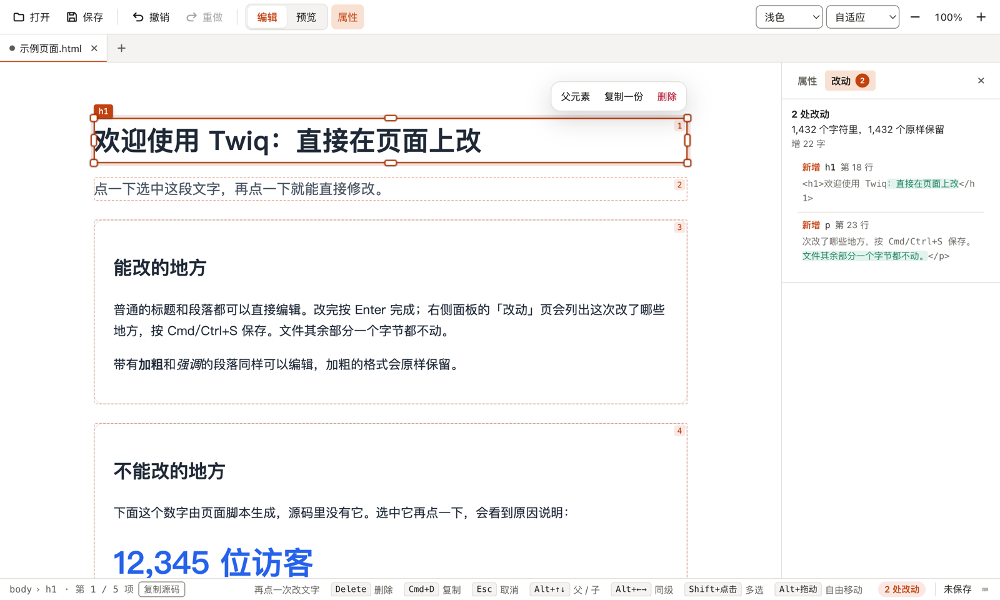

# Twiq

[English](README.md) · **简体中文**

**Twiq**（读音同 tweak，「微调」）：打开本地 HTML 文件，在渲染好的页面上直接点击修改文字；保存时只改动被改的那几个字符，文件其余部分一字节不变。

适合修改 AI 生成的落地页、报告、幻灯片等静态页面：不用在源码里找字，也不会因为「所见即所得」把整份文件重新格式化。



界面有简体中文与英文，默认跟随系统语言（「查看 › 语言」切换）。

## 功能

- **就地改字**：单击选中，再点一次改字；Enter / Esc 完成，撤销重做按补丁进行。
- **最小改动保存**：保留原文件的缩进、属性顺序、实体写法、BOM 与换行风格。
- **看得见每一处改动**：属性面板的「改动」页列出上次保存以来改了哪些地方（带行号与上下文），点一条在页面上定位，可以只撤回其中一处；保存时告诉你多少字符原样保留。
- **结构编辑**：选中任意块，删除、复制、拖放换位、自由移动、缩放手柄与吸附对齐、多选。
- **属性面板**：文字颜色、背景、字号、字重、行距、对齐、内边距、圆角、尺寸；替换图片；任意元素编辑源码（输入即预览）；SVG 结构化编辑。
- **和 AI 工具配合**：「复制给 AI」把元素源码连同文件路径、行号、CSS 选择器放进剪贴板，让 AI 助手只改这一段；AI 改完保存文件，Twiq 自动载入，你有未保存的修改时三方合并。
- **文件**：多标签页、外部修改检测、插入图片 / 视频 / 音频、导出 PDF / Markdown / 纯文本。
- **安全预览**：页面在独立的 `hw://` 协议下加载，未经允许不能读取所在目录之外的文件。
- 浅色 / 深色外观，默认跟随系统。

不支持的情况：正文由 React、Vue 等在浏览器端渲染的页面（打开时提示一次，脚本生成的文字不能改）；非 UTF-8 编码或换行风格混杂的文件（只读打开）。

## 常见问题

**会把我的文件重新排版吗？** 不会。Twiq 从不重新序列化 HTML，每次修改都是只覆盖改动字符的补丁；保存前可以在「改动」页逐处核对。

**会联网发送什么吗？** 不会。没有账号、没有统计上报、不检查更新。打开的页面自己引用的远程资源（字体、图片）会像在浏览器里一样加载；链接要你确认后才交给系统浏览器打开。

**设置存在哪里？** 应用数据目录下的 `settings.json`：macOS 是 `~/Library/Application Support/Twiq/`，Windows 是 `%APPDATA%\Twiq\`。删掉即恢复默认。

**什么样的页面最合适？** 文字写在 HTML 源码里的静态页面：AI 生成的落地页、报告、HTML 幻灯片、文档。[docs/spec.md](docs/spec.md) 附录 A 有可以直接交给 AI 的写法约束。

## 环境依赖

| | 版本 | 说明 |
|---|---|---|
| 操作系统 | macOS（Apple 芯片或 Intel）或 Windows 10/11 x64 | Linux 也许能跑开发模式，但没有测试、也不打包 |
| Node.js | 24 或更新 | CI 用 24；26 也验证过 |
| pnpm | 10 | `npm install -g pnpm@10`（Node 24 自带 corepack，也可以 `corepack enable`） |
| Git | 较新版本即可 | |
| 网络 | 首次安装需要能访问 GitHub | `pnpm install` 会下载 Electron 二进制（约 100 MB）。有代理时加 `NODE_USE_ENV_PROXY=1`；用镜像可设 `ELECTRON_MIRROR` |

不需要 Xcode、Visual Studio 或 Python：项目没有原生模块。

## 从源码构建与运行

```bash
git clone <仓库地址> twiq
cd twiq
npm install -g pnpm@10        # 没装 pnpm 时，每台机器执行一次
pnpm install

pnpm dev                      # 开发模式（热更新）
pnpm build && pnpm start      # 运行构建产物
pnpm build && npx electron . path/to/page.html   # 直接打开某个文件
```

### 打包

```bash
pnpm dist:mac                 # release/<版本>/ 下的 dmg、zip（arm64 与 x64）
pnpm dist:win                 # release/<版本>/ 下的 NSIS 安装包与 zip（x64）
```

`dist:win` 请在 Windows 上执行。在 macOS 上只能打 zip（`npx electron-builder --win zip`），NSIS 安装包需要 Wine。安装包未签名，macOS 首次打开需在「访达」里右键 → 打开。

## 测试

```bash
pnpm check                    # 类型检查 + lint + 单元测试（Vitest）
pnpm test:e2e                 # 端到端测试（Playwright 驱动真实 Electron 应用，会弹出窗口）
pnpm screens [目录]            # 截关键界面状态，用于目视检查（HW_LANG=en 英文、HW_THEME=dark 深色）
pnpm coverage                 # 可编辑覆盖率（渲染版）：tests/fixtures/real*/ 样本里有多少文字能直接改
pnpm coverage:static          # 同上，静态版，只解析源码
```

## 目录

```
docs/spec.md        产品与技术规格（v0.1 的设计依据；代码注释里的「规格 x.y」指这里的章节）
src/main/           主进程：解析、host 判定、补丁、文档状态、结构操作、三方合并、hw:// 协议、标签页、
                    工作区、菜单、IPC、文件监听、设置、拖动面板时冻结预览
src/preload/        shell.ts：外壳 preload；preview.ts：预览页的编辑层；select.ts：选择与拖动；overlay/：叠加层
src/renderer/       应用外壳（React）
src/shared/         共享类型、界面文案（中英）、定位与吸附算法
design/tokens.json  设计 token，pnpm tokens 生成 src/renderer/src/tokens.css
build/              应用图标（icon.svg 是设计源）
tests/              unit/ 单元测试，e2e/ 端到端测试，fixtures/ 测试页面
resources/          示例文档
```

## 版本

见 [CHANGELOG.md](CHANGELOG.md)。推送 `vX.Y.Z` 标签会打出 macOS 与 Windows 安装包并生成 GitHub Release 草稿（`.github/workflows/release.yml`）。

## 参与

见 [CONTRIBUTING.md](CONTRIBUTING.md) 与 [AGENTS.md](AGENTS.md)。第三方许可见 [THIRD_PARTY_LICENSES.md](THIRD_PARTY_LICENSES.md)；与 Tencent/page-harness 的对比见 [docs/compare-page-harness.md](docs/compare-page-harness.md)。

## 许可

[MIT](LICENSE) © 2026 Roger Luo
